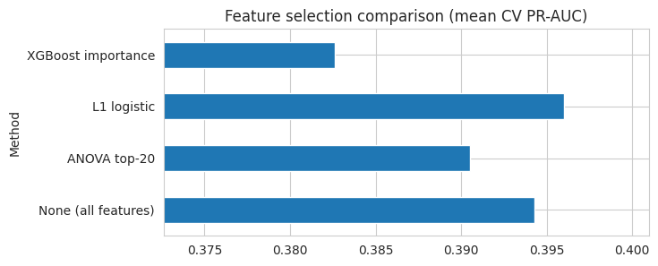
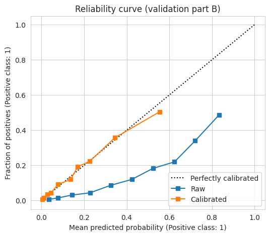
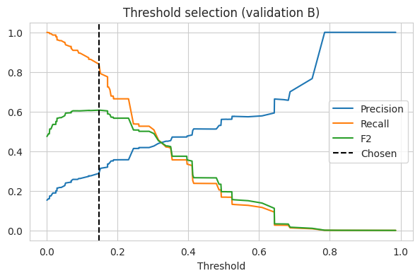
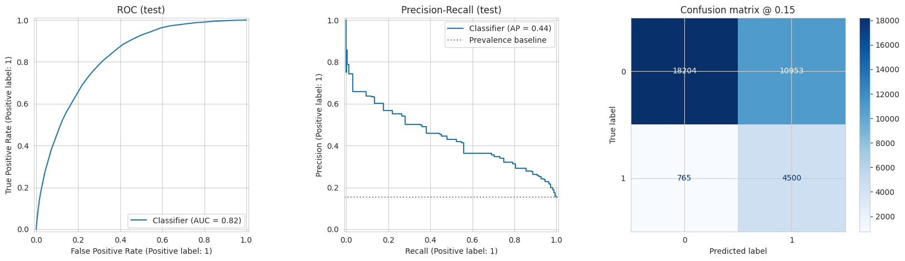
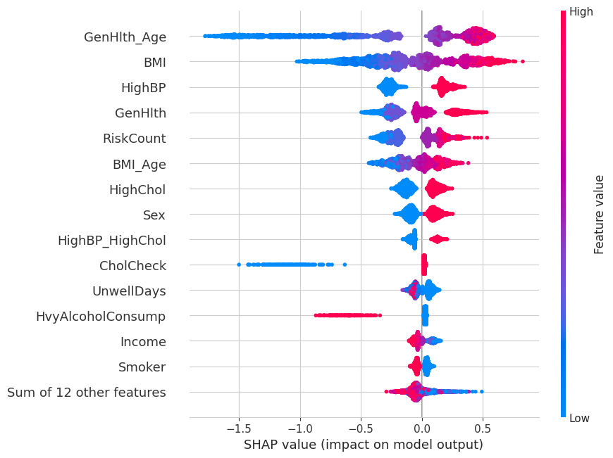

# Diabetes Risk Classification on CDC BRFSS Health Indicators

[](https://colab.research.google.com/github/YOUR_USERNAME/YOUR_REPO/blob/main/diabetes_cdc_brfss_v2.ipynb)

A machine learning pipeline that estimates diabetes / prediabetes risk from 21 self-reported health, lifestyle and demographic indicators. It covers pre-processing, EDA, feature engineering, feature selection, Bayesian hyperparameter optimization, probability calibration, threshold selection and a subgroup check, on about 230,000 survey respondents.

> **Scope:** this is a *screening / risk-stratification* model built on self-reported survey data (no lab values). It is a research and learning project, not a diagnostic tool.

## Dataset

- **CDC Diabetes Health Indicators**, from the CDC's Behavioral Risk Factor Surveillance System (BRFSS), 2015 survey.
- UCI Machine Learning Repository, id 891: https://archive.ics.uci.edu/dataset/891/cdc%2Bdiabetes%2Bhealth%2Bindicators
- Kaggle copy: https://www.kaggle.com/datasets/alexteboul/diabetes-health-indicators-dataset
- 253,680 rows originally, 21 features, no missing values.
- **24,206 exact duplicate rows were removed before splitting** (to prevent identical rows landing in both train and test), leaving **229,474 rows**.
- Target `Diabetes_binary`: 0 = no diabetes, 1 = prediabetes or diabetes. After de-duplication, **15.3% are positive** (35,097 people). A model that always predicts "no" would be 84.7% accurate, so accuracy is not used as the headline metric.

## Pipeline

| Step | What was done |
|---|---|
| Split | Stratified **train / validation / test = 70 / 15 / 15** (about 160.6K / 34.4K / 34.4K). Validation is halved: part A fits the calibrator, part B checks calibration and picks the threshold. The test set is used once, at the end. |
| EDA | Prevalence by age, BMI band, self-rated health, income, blood pressure and activity; correlation with target. |
| Feature engineering | Risk-factor count, lifestyle score, BMI obesity flag and BMI², age/health/BMI interactions, total unwell days, socio-economic composite (30 features in total). |
| Feature selection | Compared four methods inside the CV pipeline (so selection never sees held-out data): none, ANOVA top-20, L1 logistic regression, XGBoost importance. |
| Models | Logistic Regression, SVM (RBF, fit on a stratified 10,000-row subsample per fit because kernel SVMs do not scale), Random Forest, XGBoost, and a stacking ensemble. |
| Imbalance | Cost-sensitive learning (class weights), no synthetic oversampling. |
| Optimization | Optuna (Bayesian / TPE), 20 trials per model, 5-fold CV on a 30,000-row stratified subsample, objective = PR-AUC. Final models are trained on the full training set. |
| Calibration | Isotonic regression fit on validation part A. |
| Threshold | Chosen on validation part B by maximizing F2 (recall weighted 2x over precision). |
| Evaluation | ROC-AUC, PR-AUC, recall, precision, F1, Brier score, with 95% bootstrap confidence intervals. |
| Interpretation | SHAP and permutation importance (plots in the notebook). |
| Fairness check | Test performance by sex, age band and income band. |

## Results

### Ablation: did feature engineering help?
5-fold CV on the tuning subsample (mean +/- std).

| Features | Logistic Regression PR-AUC | XGBoost PR-AUC |
|---|---|---|
| Raw features | 0.393 +/- 0.005 | 0.374 +/- 0.005 |
| + feature engineering | **0.414 +/- 0.005** | 0.374 +/- 0.011 |

Feature engineering improved the linear model (+0.021 PR-AUC) and made no difference to XGBoost, which can learn such interactions on its own.

### Feature selection
| Method | Features kept | Mean PR-AUC |
|---|---|---|
| None | 30 | 0.3943 |
| ANOVA top-20 | 20 | 0.3905 |
| **L1 logistic (chosen)** | **26** | **0.3960** |
| XGBoost importance | 15 | 0.3826 |

L1 selection kept 26 of 30 features (dropped `Veggies`, `MentHlth`, `DiffWalk`, `Education`) at the same performance as using all features. The gap to "no selection" (0.002) is within noise, so the practical benefit is a slightly simpler model, not higher accuracy.

### Model comparison (validation set)
Random-model PR-AUC baseline = prevalence = 0.153.

| Model | PR-AUC | ROC-AUC |
|---|---|---|
| **XGBoost (selected)** | 0.4344 | 0.8169 |
| Stacking ensemble | 0.4340 | 0.8170 |
| Random Forest | 0.4291 | 0.8132 |
| Logistic Regression | 0.4244 | 0.8131 |
| SVM | 0.4223 | 0.8112 |

All five models are within about 0.01 PR-AUC of each other, so the choice of model matters less than the data. The stacking ensemble did not beat XGBoost.

### Calibration
Class weighting makes raw scores overstate risk. Isotonic calibration cut the validation Brier score from **0.1814 to 0.1067** and brought the reliability curve close to the diagonal.

### Final test results (n = 34,422, used once)
Calibrated XGBoost. Values are point estimate [95% bootstrap CI].

| Metric | Threshold 0.5 | Threshold 0.147 (validation-tuned) |
|---|---|---|
| ROC-AUC | 0.822 [0.816, 0.826] | 0.822 [0.816, 0.826] |
| PR-AUC | 0.438 [0.425, 0.451] | 0.438 [0.425, 0.451] |
| Brier score | 0.104 [0.103, 0.106] | 0.104 [0.103, 0.106] |
| Recall | 0.177 [0.168, 0.187] | **0.855 [0.845, 0.864]** |
| Precision | 0.602 [0.578, 0.624] | 0.291 [0.284, 0.298] |
| F1 | 0.274 [0.261, 0.287] | 0.434 [0.426, 0.443] |
| Accuracy | 0.856 [0.853, 0.859] | 0.660 [0.655, 0.665] |

At the default 0.5 threshold the model misses 82% of positive cases. Lowering the threshold to 0.147 (chosen on validation data only) catches about 86% of them, at the cost of more false alarms: roughly 3 in 10 flagged people are truly positive (about 1.9x the 15.3% base rate).

### Subgroup performance (test set, threshold 0.147)
| Group | Level | n | Prevalence | ROC-AUC | Recall | Precision |
|---|---|---|---|---|---|---|
| Sex | Female | 19,075 | 0.142 | 0.835 | 0.844 | 0.292 |
| Sex | Male | 15,347 | 0.167 | 0.804 | 0.866 | 0.290 |
| Age | codes 1-4 (~18-39) | 5,256 | 0.032 | 0.833 | **0.412** | 0.219 |
| Age | codes 5-8 (~40-59) | 12,096 | 0.125 | 0.828 | 0.780 | 0.282 |
| Age | codes 9-13 (~60+) | 17,070 | 0.210 | 0.772 | 0.907 | 0.297 |
| Income | codes 1-3 (lowest) | 5,652 | 0.247 | 0.788 | 0.924 | 0.346 |
| Income | codes 4-6 | 12,083 | 0.170 | 0.805 | 0.879 | 0.291 |
| Income | codes 7-8 (highest) | 16,687 | 0.109 | 0.827 | 0.774 | 0.255 |

Ranking quality (ROC-AUC) is similar across groups, but **one global threshold gives very uneven recall**: only 41% of positive cases are caught in the 18-39 group versus 91% in the 60+ group. Age-specific thresholds would be a natural next step.

### Model interpretation (SHAP)
SHAP on the tuned XGBoost shows that the strongest drivers of predicted risk are the engineered general-health x age interaction (`GenHlth_Age`), BMI, high blood pressure, self-rated general health, the risk-factor count, BMI x age, high cholesterol and sex. Higher BMI, high blood pressure, high cholesterol, poorer self-rated health and older age all push predicted risk up.

Two patterns look counter-intuitive and should be read as associations in survey data, not causal effects: heavy alcohol consumption and not having had a recent cholesterol check both *lower* predicted risk. Plausible explanations are reverse causation (people already diagnosed with diabetes are often advised to cut alcohol) and detection bias (people who are never screened are less likely to have a diagnosis on record). None of this is health advice.

## Figures

| | |
|---|---|
|  |  |
|  |  |
|  |  |

## Limitations

- Self-reported survey data from a single year (2015) and a single country; results may not transfer to other populations or years.
- No laboratory values (glucose, HbA1c), which caps achievable performance.
- The prediabetes and diabetes classes are merged in the target.
- The threshold was tuned for recall; the right trade-off in practice depends on clinical cost and follow-up capacity.
- The SVM is trained on a subsample, so it is not directly comparable in data use to the other models.

## Repository layout

```
.
├── diabetes_cdc_brfss_v2.ipynb      # full pipeline (run top to bottom)
├── README.md
├── requirements.txt                 # numpy pandas scikit-learn xgboost optuna shap ucimlrepo matplotlib seaborn joblib
├── figures/                         # PNG plots used in this README
└── results/
    ├── ablation_results.csv
    ├── feature_selection_results.csv
    ├── validation_results.csv
    ├── test_results.csv
    └── subgroup_results.csv
```

## How to run

Open the notebook in Google Colab (badge above) and use Runtime > Run all. The data loads automatically from UCI through `ucimlrepo`; if that fails, the notebook asks you to upload the Kaggle CSV. The default settings take roughly an hour on free Colab. Lower `N_TRIALS` and `TUNE_N` in the setup cell for a faster run.

To reload the saved model with `joblib`, define the `ClinicalFeatures` and `SubsampledSVM` classes from the notebook first.
